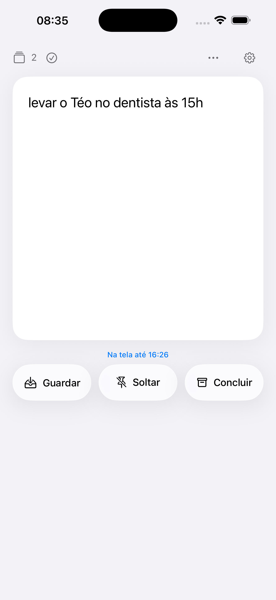
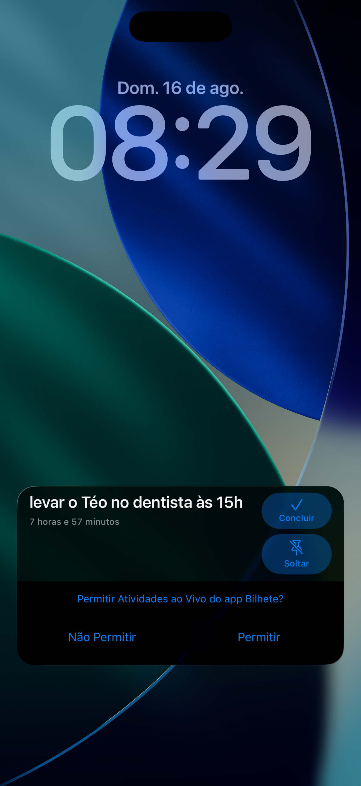
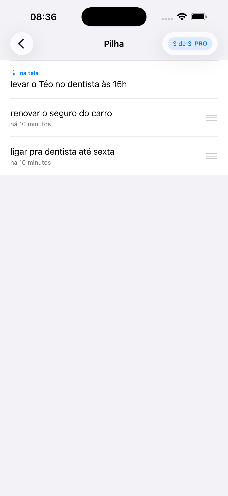

# Bilhete

App iOS que deixa uma nota na tela de bloqueio: um bilhete em destaque por vez, e os outros numa pilha atrás.

[Baixar na App Store](https://apps.apple.com/br/app/bilhete/id6802047520)

<p>
  
  
  
</p>

## Principais funcionalidades

- Bilhete em destaque com edição direta e salvamento automático.
- Fixação na tela de bloqueio e na Dynamic Island via Live Activity, com botão de concluir.
- Pilha de bilhetes guardados, com promoção a destaque e reordenação; concluídos ficam numa lista própria, com restaurar e excluir.
- Widgets de tela de início e de tela de bloqueio.
- Controle da Central de Controle e Botão de Ação para refixar e criar bilhete; Siri e Atalhos.
- Aviso opcional (notificação local) antes de a fixação expirar.
- Armazenamento 100% local, sem conta e sem sincronização, com exportação de tudo.
- Compra única "Bilhete Pro" (StoreKit 2); escrever, fixar, ver e concluir são grátis.
- Português do Brasil e inglês, com seletor de idioma no app.

## Stack técnica

- Swift, SwiftUI, iOS 18+ (só iPhone)
- SwiftData local num App Group, compartilhado entre app e widgets pelo Swift Package `BilheteCore`
- ActivityKit (Live Activity), WidgetKit (widgets e Controles), App Intents (Siri, Atalhos, Botão de Ação)
- StoreKit 2 (compra não-consumível), UserNotifications (aviso local)
- XcodeGen (`project.yml`), XCTest e XCUITest, String Catalog gerado por script Python

## Como foi construído

O app foi desenvolvido com Claude (Anthropic) a partir de uma especificação SDD, o [`SDD-Bilhete.md`](SDD-Bilhete.md), com o modelo de dados em [`modelo-bilhete.dbml`](modelo-bilhete.dbml). As decisões tomadas depois da spec, que prevalecem sobre ela, estão no [`CLAUDE.md`](CLAUDE.md), e o sistema como foi implementado, com as divergências, em [`DOCUMENTACAO-TECNICA.md`](DOCUMENTACAO-TECNICA.md).

O que existe no repositório para manter a qualidade:

- [`CLAUDE.md`](CLAUDE.md) com as regras permanentes lidas pelo Claude Code a cada sessão: decisões de produto, convenções, regras de plataforma que não podem ser quebradas e os números de negócio (todos vindos da spec).
- Testes automatizados (`BilheteTests/`) das invariantes do modelo, das regras numéricas, da máquina de estados, do editor, da Live Activity, das restrições dos widgets, dos intents e Controles, do armazenamento, do StoreKit e da localização.
- Uma guarda de build ([`Scripts/check-no-model-collections.sh`](Scripts/check-no-model-collections.sh)) que roda antes de compilar e derruba o build se alguma classe `@Model` declarar propriedade `Array` ou `Set` (proteção contra uma falha de migração conhecida do SwiftData).
- Teste de UI (`BilheteUITests/`) que gera o print do paywall para a revisão da compra no App Store Connect.

## Status

Publicado na App Store (iOS).

## Como rodar

Requer Xcode 26+ e [XcodeGen](https://github.com/yonaskolb/XcodeGen) (`brew install xcodegen`).

```bash
xcodegen generate && open Bilhete.xcodeproj
```

O `.xcodeproj` é gerado e não é versionado: mudanças de target, arquivo ou configuração vão no `project.yml`, seguidas de `xcodegen generate`. Para instalar num aparelho, troque o `DEVELOPMENT_TEAM` em `Bilhete.xcconfig` pelo seu time.

Testes:

```bash
xcodebuild test -scheme Bilhete -destination 'platform=iOS Simulator,name=iPhone 17 Pro' -only-testing:BilheteTests
```

Guarda do modelo, à mão:

```bash
SRCROOT="$PWD" bash Scripts/check-no-model-collections.sh
```

### Estrutura

```
project.yml                  ← targets e configuração (XcodeGen)
Bilhete.xcconfig             ← bundle id, App Group, produto do StoreKit
Bilhete.storekit             ← loja local para desenvolvimento e teste
Packages/BilheteCore/        ← tudo que app e widget compartilham
  Sources/BilheteCore/
    Models/                  ← @Model, enums e schema versionado
    Store/                   ← BilheteStore, container, exportação
    Intents/                 ← App Intents
    Entitlement/             ← EntitlementStore e PaywallGate
    LiveActivity/            ← BilheteAttributes e PinService
    Notifications/           ← aviso de expiração
    Preferences/             ← UserDefaults do App Group
    Resources/               ← paleta e strings compartilhadas
App/                         ← target principal, uma pasta por tela
Widgets/                     ← widgets, Live Activity e Controles
BilheteTests/                ← testes de unidade
BilheteUITests/              ← captura do print da loja
Scripts/                     ← guarda do modelo e gerador do String Catalog
design/                      ← telas desenhadas no Claude Design
```

O que só se valida em aparelho real (Controle na tela de bloqueio, Botão de Ação, Siri por voz, legibilidade dos widgets, desempenho) está listado na seção de pendências da documentação técnica.

## Licença

O código está disponível apenas para leitura e estudo. Veja [LICENSE](LICENSE).

## Contribuições

Issues são bem-vindas; pull requests não são aceitos. Veja [CONTRIBUTING.md](CONTRIBUTING.md).

---

Feito pela [Dab Lab](https://www.dablab.com.br/) — product studio de software e IA que constrói apps para pequenas empresas, startups e áreas dentro de grandes empresas, partindo de uma especificação (Spec-Driven Development) e com as disciplinas de engenharia de software robusta.
